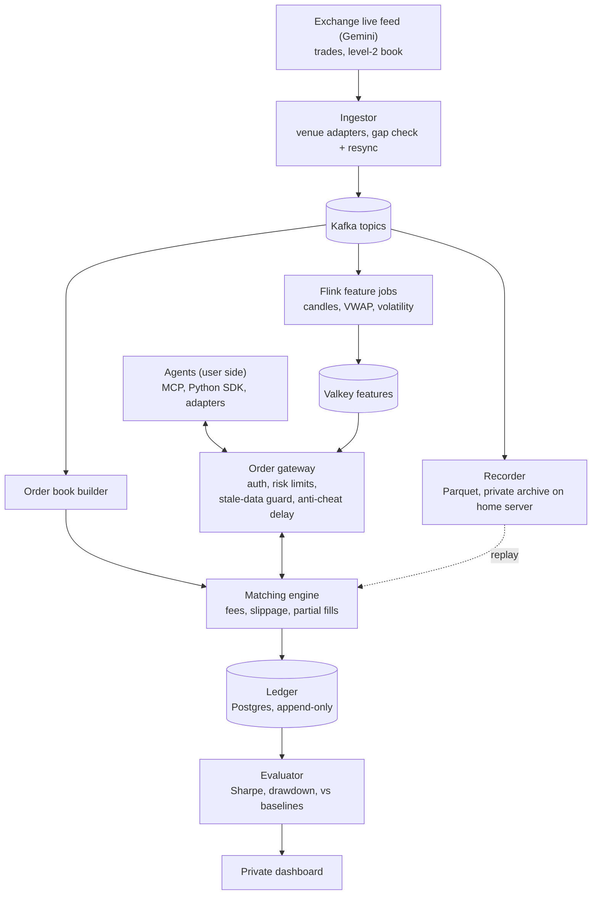

# SimEx

**A personal, live practice market for testing whether an AI can really trade.**
Live exchange prices, simulated money, honest fills.

> **Status: week 1, live data in.** Nothing trades yet. The plan, architecture and decisions are in
> [`docs/`](docs/); the build follows the roadmap below.
>
> **Scope:** SimEx is a personal research tool. The code is open source; it runs as a private
> instance for its owner and does not publish market data, recordings or leaderboards, because
> exchange data terms allow personal use only ([ADR 0010](docs/adr/0010-personal-use-and-gemini-market-data.md)).
> To run your own, you connect to the exchange yourself under its terms.

---

## Why this exists

LLM trading demos usually test models on old prices or on paper brokers that fill every order
instantly at a perfect price. Both flatter the model:

- **Backtests on historical data are contaminated.** A model may have seen that period in training
  and effectively "remember" what happened.
- **Idealized fills hide real costs.** Real markets charge fees, move while you're buying, and fill
  big orders at worse prices.

SimEx is the honest test: a simulated exchange driven by the **live** order book, with fees,
slippage, delay and partial fills, that an agent plugs into. Live forward-testing is the only
score that counts.

## How it works



- **Plug in three ways:** an MCP server (Claude and other MCP clients trade with zero code), a
  REST + WebSocket API with a Python SDK, or adapters for popular agent frameworks.
- **Bring your own key:** agents run outside SimEx with their own LLM key. SimEx never runs agent code.
- **Pluggable market sources:** each exchange is an adapter behind one envelope and topic layout, so
  everything downstream is venue-independent.
- **Fair under lag:** fills happen against the book when an order *arrives*, with a fixed anti-cheat
  delay so bots on faster direct feeds can't trade against a slightly stale book. Fills pause if the
  feed goes stale.
- **Exactly-once ledger:** every fill is recorded once, money uses `Decimal`, and a reconciliation
  job proves balances.
- **Replay Playground (v1.1):** practice on saved data with the same engine. Playground scores are
  kept separate from live forward-test scores.

## Roadmap

| When | Phase | Gate (must pass to move on) |
| --- | --- | --- |
| Days 1–3 | Setup | Whole stack starts with one command |
| Week 1 | Live data in | 24h run on Gemini with no unrecovered gaps; book matches fresh snapshots |
| Week 2 | Exchange core | **Demo:** Claude trades live via MCP; ledger reconciles to the cent |
| Week 3 | Plug-ins | A new agent connects using only the docs |
| Week 4 | Features and agents | All agents run 72h unattended within the LLM cost cap |
| Week 5 | Scoring | Private scoreboard shows live rankings and reasoning per trade |
| Week 6 | Harden and deploy | Runs 7 days unattended on Oracle; write-up of architecture and system metrics |
| Week 7 | Replay Playground (v1.1) | Agents replay a past window; scores stay separate from live |

Full task lists, risks and metrics: [`docs/PLAN.md`](docs/PLAN.md).

## Tech stack

Python 3.12 · Apache Kafka · Apache Flink · FastAPI · PostgreSQL · Valkey (Redis-compatible) · Parquet + Iceberg ·
DuckDB · MCP Python SDK · Next.js · Prometheus + Grafana · OpenTelemetry · Docker · Terraform · Oracle Cloud (ARM64) · Cloudflare Tunnel ·
GitHub Actions

## Repository layout

```
simex/
├── src/simex/          Python services (one subpackage per component)
│   ├── ingest/         Venue adapters (Gemini; Coinbase for research), gap detection, resync
│   ├── book/           Order book builder
│   ├── exchange/       Order gateway, matching engine, guards
│   ├── ledger/         Event-sourced ledger and reconciliation
│   ├── recorder/       Raw feed to Parquet/Iceberg, replay reader
│   ├── features/       Flink feature jobs
│   ├── agents/         Baseline and LLM reference agents
│   ├── evaluator/      Scoring against baselines
│   ├── mcp/            MCP server
│   └── playground/     Replay Playground (v1.1)
├── sdk/python/         Client SDK
├── web/                Private dashboard
├── infra/              Prometheus config, Terraform (Cloudflare, Azure)
├── docs/               Plan and architecture decision records
└── tests/
```

## Local development

Requires Python 3.12+ and Docker (Docker Desktop on Windows/macOS). Every image is multi-arch, so the
same stack runs on an x86 laptop and on the ARM64 production server.

```bash
cp .env.example .env              # then change the passwords
python -m venv .venv && source .venv/bin/activate    # Windows: .venv\Scripts\Activate.ps1
pip install -e ".[dev]"

make up       # docker compose up -d --wait: Kafka, Postgres, Valkey, Prometheus
make smoke    # Kafka produce/consume, Postgres SELECT 1, Valkey SET/GET; PASS/FAIL per service
make ps       # status and health
make logs     # follow logs (make logs s=kafka for one service)
make down     # stop; data stays in named volumes (docker compose down -v deletes it)

ruff check . && ruff format --check . && pytest
```

On Windows without `make`, use `.\scripts\dev.ps1 up` (same targets: `up`, `down`, `logs`, `ps`,
`smoke`, `ingest`), or the plain `docker compose` commands.

| Service | Host port | Memory limit | Notes |
| --- | --- | --- | --- |
| Kafka 3.9 (KRaft, single node) | 9092 | 1.25 GB | Heap `-Xms512m -Xmx768m`; containers use `kafka:29092` |
| Postgres 16 | 5432 | 1 GB | `shared_buffers=256MB` |
| Valkey 8 (Redis-compatible) | 6379 | 256 MB | `maxmemory 192mb`, `allkeys-lru` |
| Prometheus | 9090 | 512 MB | 15 days / 2 GB retention |
| Grafana | 3000 | 256 MB | Off by default: `docker compose --profile monitoring up -d` |

Ports bind to `127.0.0.1` only; on the server, reach them through an SSH tunnel. The default stack
uses about 3 GB of the server's 12 GB, leaving room for the SimEx services.

### Coinbase ingestor

> The Coinbase adapter is for feed research only: its terms forbid using the data to benchmark AI
> agents, so it never feeds the matching engine or scoring ([ADR 0010](docs/adr/0010-personal-use-and-gemini-market-data.md)).
> The Gemini adapter replaces it as the live source.

`make ingest` (or `python -m simex.ingest`) connects to the public Coinbase WebSocket, subscribes
to `level2`, `market_trades` and `heartbeats` for the configured pairs, and publishes every message
to Kafka topics `md.level2`, `md.trades` and `md.heartbeats` (envelope format:
[ADR 0007](docs/adr/0007-market-data-envelope-and-topics.md)).
It creates the topics if missing, reconnects with jittered backoff, and treats 10s without a
message as a stale socket. On a sequence gap or disconnect it publishes a resync marker per product
to `md.level2`, records the gap on `md.gaps`, and resubscribes level2 for fresh snapshots, falling
back to a reconnect ([ADR 0008](docs/adr/0008-gap-resync-markers-and-gap-records.md)). To exercise
that path against the live feed, set `SIMEX_INGEST_DROP_EVERY=500` (dev only; it drops every
500th message on purpose).

For stale-data checks use `simex_ingest_last_message_age_seconds{product_id,channel}` together
with `simex_ingest_awaiting_snapshot{product_id}`. Quiet products can go seconds without a trade,
so `market_trades` age reflects trading activity; `level2` and `heartbeats` age reflect the feed.
`simex_ingest_time_since_last_snapshot_seconds` is not a staleness signal: Coinbase only sends a
snapshot on subscribe, so it grows for as long as the connection is healthy. Metrics (messages, feed lag, gaps, reconnects) are at
`http://127.0.0.1:9101/metrics` and scraped by Prometheus. Settings are environment variables
listed in `.env.example`; the defaults suit the local stack.

Feed lag is local receive time minus the Coinbase timestamp, so it is only meaningful on an
NTP-synced clock. A clock running behind shows up as negative lag (a laptop ~300 ms slow gave a
p50 of -285 ms); check with `w32tm /query /status` on Windows or `timedatectl` on Linux.

```bash
make ingest                                  # leave running
python scripts/ingest_report.py --seconds 120   # msg/s, lag p50/p99, gaps, a sample trade
```

Or open the repo in a GitHub Codespace; the dev container installs everything.

## Decisions

Architecture decisions are recorded in [`docs/adr/`](docs/adr/).

## Disclaimer

SimEx is a simulation and personal research tool. It uses simulated money only, places no real
orders, and nothing in it is financial or investment advice. It ships no market data; anyone running
it connects to an exchange themselves and is responsible for following that exchange's terms.

## License

[Apache-2.0](LICENSE)
