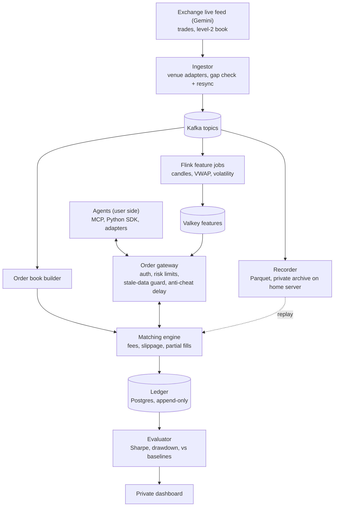

# SimEx

**A personal, live practice market for testing whether an AI can really trade.**
Live exchange prices, simulated money, honest fills.

> **Status: week 1, live data in.** Nothing trades yet. The plan, architecture and decisions are in
> [`docs/`](docs/); the build follows the roadmap below.
>
> **Scope:** SimEx is a personal research tool. The code is open source; it runs as a private
> instance for its owner and does not publish market data, recordings or leaderboards, because
> exchange data terms allow personal use only ([ADR 0010](docs/adr/0010-personal-use-and-gemini-market-data.md)).
> To run your own, you connect to the exchange yourself under its terms.

---

## Why this exists

LLM trading demos usually test models on old prices or on paper brokers that fill every order
instantly at a perfect price. Both flatter the model:

- **Backtests on historical data are contaminated.** A model may have seen that period in training
  and effectively "remember" what happened.
- **Idealized fills hide real costs.** Real markets charge fees, move while you're buying, and fill
  big orders at worse prices.

SimEx is the honest test: a simulated exchange driven by the **live** order book, with fees,
slippage, delay and partial fills, that an agent plugs into. Live forward-testing is the only
score that counts.

## How it works



- **Plug in three ways:** an MCP server (Claude and other MCP clients trade with zero code), a
  REST + WebSocket API with a Python SDK, or adapters for popular agent frameworks.
- **Bring your own key:** agents run outside SimEx with their own LLM key. SimEx never runs agent code.
- **Pluggable market sources:** each exchange is an adapter behind one envelope and topic layout, so
  everything downstream is venue-independent.
- **Fair under lag:** fills happen against the book when an order *arrives*, with a fixed anti-cheat
  delay so bots on faster direct feeds can't trade against a slightly stale book. Fills pause if the
  feed goes stale.
- **Exactly-once ledger:** every fill is recorded once, money uses `Decimal`, and a reconciliation
  job proves balances.
- **Replay Playground (v1.1):** practice on saved data with the same engine. Playground scores are
  kept separate from live forward-test scores.

## Roadmap

| When | Phase | Gate (must pass to move on) |
| --- | --- | --- |
| Days 1–3 | Setup | Whole stack starts with one command |
| Week 1 | Live data in | 24h run on Gemini with no unrecovered gaps; book matches fresh snapshots |
| Week 2 | Exchange core | **Demo:** Claude trades live via MCP; ledger reconciles to the cent |
| Week 3 | Plug-ins | A new agent connects using only the docs |
| Week 4 | Features and agents | All agents run 72h unattended within the LLM cost cap |
| Week 5 | Scoring | Private scoreboard shows live rankings and reasoning per trade |
| Week 6 | Harden and deploy | Runs 7 days unattended on Oracle; write-up of architecture and system metrics |
| Week 7 | Replay Playground (v1.1) | Agents replay a past window; scores stay separate from live |

Full task lists, risks and metrics: [`docs/PLAN.md`](docs/PLAN.md).

## Tech stack

Python 3.12 · Apache Kafka · Apache Flink · FastAPI · PostgreSQL · Valkey (Redis-compatible) · Parquet + Iceberg ·
DuckDB · MCP Python SDK · Next.js · Prometheus + Grafana · OpenTelemetry · Docker · Terraform · Oracle Cloud (ARM64) · Cloudflare Tunnel ·
GitHub Actions

## Repository layout

```
simex/
├── src/simex/          Python services (one subpackage per component)
│   ├── ingest/         Venue adapters (Gemini; Coinbase for research), gap detection, resync
│   ├── book/           Order book builder
│   ├── exchange/       Order gateway, matching engine, guards
│   ├── ledger/         Event-sourced ledger and reconciliation
│   ├── recorder/       Raw feed to Parquet/Iceberg, replay reader
│   ├── features/       Flink feature jobs
│   ├── agents/         Baseline and LLM reference agents
│   ├── evaluator/      Scoring against baselines
│   ├── mcp/            MCP server
│   └── playground/     Replay Playground (v1.1)
├── sdk/python/         Client SDK
├── web/                Private dashboard
├── infra/              Prometheus config, Terraform (Cloudflare, Azure)
├── docs/               Plan and architecture decision records
└── tests/
```

## Local development

Requires Python 3.12+ and Docker (Docker Desktop on Windows/macOS). Every image is multi-arch, so the
same stack runs on an x86 laptop and on the ARM64 production server.

```bash
cp .env.example .env              # then change the passwords
python -m venv .venv && source .venv/bin/activate    # Windows: .venv\Scripts\Activate.ps1
pip install -e ".[dev]"

make up       # docker compose up -d --wait: Kafka, Postgres, Valkey, Prometheus
make smoke    # Kafka produce/consume, Postgres SELECT 1, Valkey SET/GET; PASS/FAIL per service
make ps       # status and health
make logs     # follow logs (make logs s=kafka for one service)
make down     # stop; data stays in named volumes (docker compose down -v deletes it)

ruff check . && ruff format --check . && pytest
```

On Windows without `make`, use `.\scripts\dev.ps1 up` (same targets: `up`, `down`, `logs`, `ps`,
`smoke`, `ingest`), or the plain `docker compose` commands.

| Service | Host port | Memory limit | Notes |
| --- | --- | --- | --- |
| Kafka 3.9 (KRaft, single node) | 9092 | 1.25 GB | Heap `-Xms512m -Xmx768m`; containers use `kafka:29092` |
| Postgres 16 | 5432 | 1 GB | `shared_buffers=256MB` |
| Valkey 8 (Redis-compatible) | 6379 | 256 MB | `maxmemory 192mb`, `allkeys-lru` |
| Prometheus | 9090 | 512 MB | 15 days / 2 GB retention |
| Grafana | 3000 | 256 MB | Off by default: `docker compose --profile monitoring up -d` |

Ports bind to `127.0.0.1` only; on the server, reach them through an SSH tunnel. The default stack
uses about 3 GB of the server's 12 GB, leaving room for the SimEx services.

### Market-data ingestor

`make ingest` (or `python -m simex.ingest`) streams one venue's public market data into Kafka.
The live venue is **Gemini** (`SIMEX_VENUE=gemini`, the default): one connection to
`wss://ws.gemini.com?snapshot=-1` with `{symbol}@depth@100ms` and `{symbol}@trade` for each pair,
published to `md.level2` and `md.trades`, keyed by normalized product IDs (`BTC-USD`). Every venue
sits behind the same adapter interface and envelope
([ADR 0011](docs/adr/0011-venue-adapters-and-gemini-gap-rule.md), envelope v3 extends
[ADR 0007](docs/adr/0007-market-data-envelope-and-topics.md)); consumers read payloads through
`simex.marketdata.decode`, never a venue's raw format.

```bash
docker compose up -d                         # Kafka and the rest of the stack
make ingest                                  # leave running (Gemini); Windows: .\scripts\dev.ps1 ingest
python scripts/ingest_report.py --seconds 120   # msg/s, lag p50/p99, gaps, resyncs, counters
```

- **Gaps** ([ADR 0011](docs/adr/0011-venue-adapters-and-gemini-gap-rule.md)): every Gemini diff must
  start where the previous one ended (`U == previous u`). A break resyncs only that product: a
  resync marker on `md.level2`, a record on `md.gaps`, and a resubscribe of its depth stream for a
  fresh snapshot, falling back to a reconnect
  ([ADR 0008](docs/adr/0008-gap-resync-markers-and-gap-records.md)). Anything else unexpected is
  counted in `simex_ingest_protocol_drift_total` and logged as an error. To exercise the gap path,
  set `SIMEX_INGEST_DROP_EVERY=500` (dev only; drops every 500th message on purpose).
- **Snapshots:** every 30 minutes each product's snapshot is refreshed, one product at a time and
  10 minutes apart, so `md.level2` always holds a recent one to cold-start from; retention is 24 h
  / 2 GiB per partition by default ([ADR 0009](docs/adr/0009-book-cold-start-snapshot-refresh.md)).
- **Liveness:** Gemini has no heartbeats channel, so the ingestor pings every 2 s and reconnects
  after 5 s without a level2 message, ping reply or other control frame. Trades never count,
  either way: pairs can go minutes without one. `simex_ingest_ping_rtt_seconds` is the round trip.
- **Stale-data guards:** use `simex_ingest_last_message_age_seconds{venue,product_id,channel}`
  with `simex_ingest_awaiting_snapshot{venue,product_id}`, on the `level2` channel. Trades are rare
  on Gemini (one pair went 212 s without one), so `market_trades` age reflects trading, not the
  feed, and must never drive a stale-data guard.
  `simex_ingest_time_since_last_snapshot_seconds` is the age of the book's baseline, not a
  staleness signal.
- **Book audit:** every 120 s per product (`INGEST_AUDIT_SECONDS`; the pairs take turns, 40 s
  apart) the ingestor asks Gemini for the top 100 levels a side and publishes the answer on
  `md.level2` as a `type: "audit"` record, right after the diff it matches. It also serves the
  book service's requests on `ctl.resync_requests` with a single-product resync
  ([ADR 0012](docs/adr/0012-order-book-service-valkey-and-audit.md)).
- **Trades:** Gemini trade IDs are exchange-wide and not always in order, so lost trades can't be
  detected; consumers dedupe by trade ID (`simex.marketdata.TradeDeduper`).

On Windows PowerShell, piping the ingestor's output with `2>&1` (for example
`python -m simex.ingest 2>&1 | Tee-Object -FilePath ingest.log`) shows a red `NativeCommandError`
on the first log line. That is harmless: PowerShell wraps the first line Python writes to stderr,
where logging goes. The ingestor keeps running.

Metrics carry a `venue` label and are at `http://127.0.0.1:9101/metrics`, scraped by Prometheus.
Settings are environment variables listed in `.env.example`; the defaults suit the local stack.
Feed lag is local receive time minus the venue's timestamp, so it is only meaningful on an
NTP-synced clock: a clock running behind shows up as negative lag. Check it with
`w32tm /query /status` on Windows or `timedatectl` on Linux; `tools/gemini_probe.py` measures the
offset with NTP and prints corrected lag.

> **Coinbase is for feed research only.** Its terms forbid using the data to benchmark AI agents,
> so it never feeds the book, matching engine or scoring
> ([ADR 0010](docs/adr/0010-personal-use-and-gemini-market-data.md)). It runs only with
> `SIMEX_VENUE=coinbase SIMEX_COINBASE_RESEARCH=1`, and publishes to `research.coinbase.md.*`
> instead of `md.*`. Read it back with `python scripts/ingest_report.py --venue coinbase`.

### Order book service

`make book` (or `python -m simex.book`; Windows: `.\scripts\dev.ps1 book`) keeps one level-2 book per
pair from `md.level2` and publishes it to Valkey every 250 ms
([ADR 0012](docs/adr/0012-order-book-service-valkey-and-audit.md)). Run it next to the ingestor.

```bash
make ingest                                      # terminal 1
make book                                        # terminal 2
python scripts/book_report.py --seconds 60       # states, usability, counters (no prices)
```

- **The library** (`simex.book.OrderBook`) has no I/O and reads only `simex.marketdata` events.
  Prices and sizes are `Decimal`, and queries raise `BookNotReady` unless the book is SYNCED. The
  matching engine will embed it.
- **Cold start:** the service reads `md.level2` from 2x the snapshot refresh interval ago (about
  an hour), so a restart is SYNCED again within seconds (ADR 0009). Nothing is committed or
  persisted.
- **Valkey:** each pair is one JSON key, `simex:book:gemini:<pair>`, with a 2 s TTL. It holds the
  state, best bid and ask, mid, spread, the top `BOOK_PUBLISH_DEPTH` (10) levels, the last update
  ID and timestamps. **A reader may use it only if** the key exists, `state` is `SYNCED`,
  `catching_up` is false and `received_at_ns` is less than 5 s old (`simex.book.record.usable`).
- **Audit:** each book compares its top 100 levels a side, exactly, with the ingestor's audits
  (about one per product every 2 minutes). `simex_book_audits_total{outcome,reason}` counts
  `match`, `mismatch` (should stay 0), `skipped` and `unaligned`. About a third of Gemini audits
  are unaligned with `reason="inside_diff"`: Gemini answered mid-way through a 100 ms batch, so no
  point in the stream matches. The gate is 0 mismatches and at least 10 aligned audits per
  product per hour, as Prometheus alerts in `infra/prometheus/rules/`. A mismatch or a crossed
  book logs an error, drops the book to RESYNCING and asks the ingestor for a fresh snapshot on
  `ctl.resync_requests`, so it is SYNCED again within about a second rather than at the next
  30-minute refresh. Failures replayed from history at startup send no request.
- **Metrics** are at `http://127.0.0.1:9102/metrics`: book state, level counts, crossed books
  (should stay 0), audits, resyncs and resync requests, apply latency and time since the last
  snapshot or update.

Or open the repo in a GitHub Codespace; the dev container installs everything.

## Decisions

Architecture decisions are recorded in [`docs/adr/`](docs/adr/).

## Disclaimer

SimEx is a simulation and personal research tool. It uses simulated money only, places no real
orders, and nothing in it is financial or investment advice. It ships no market data; anyone running
it connects to an exchange themselves and is responsible for following that exchange's terms.

## License

[Apache-2.0](LICENSE)
