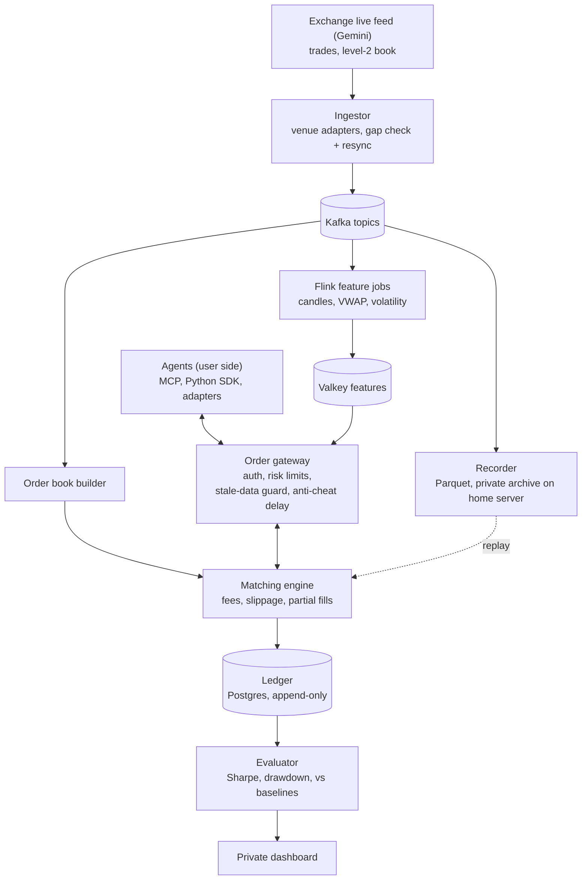

# SimEx

**A personal, live practice market for testing whether an AI can really trade.**
Live exchange prices, simulated money, honest fills.

> **Status:** the private API, Python SDK and local load test are available. Oracle ARM64
> capacity remains unmeasured. The plan and decisions are in [`docs/`](docs/).
>
> **Scope:** SimEx is a personal research tool. The code is open source; it runs as a private
> instance for its owner and does not publish market data, recordings or leaderboards, because
> exchange data terms allow personal use only ([ADR 0010](docs/adr/0010-personal-use-and-gemini-market-data.md)).
> To run your own, you connect to the exchange yourself under its terms.

---

## Why this exists

LLM trading demos usually test models on old prices or on paper brokers that fill every order
instantly at a perfect price. Both flatter the model:

- **Backtests on historical data are contaminated.** A model may have seen that period in training
  and effectively "remember" what happened.
- **Idealized fills hide real costs.** Real markets charge fees, move while you're buying, and fill
  big orders at worse prices.

SimEx is the honest test: a simulated exchange driven by the **live** order book, with fees,
slippage, delay and partial fills, that an agent plugs into. Live forward-testing is the only
score that counts.

## How it works



- **Plug in three ways:** an MCP server (Claude and other MCP clients trade with zero code), a
  REST + WebSocket API with a Python SDK, or adapters for popular agent frameworks.
- **Bring your own key:** agents run outside SimEx with their own LLM key. SimEx never runs agent code.
- **Pluggable market sources:** each exchange is an adapter behind one envelope and topic layout, so
  everything downstream is venue-independent.
- **Fair under lag:** fills happen against the book when an order *arrives*, with a fixed anti-cheat
  delay so bots on faster direct feeds can't trade against a slightly stale book. Fills pause if the
  feed goes stale.
- **Exactly-once ledger:** every fill is recorded once, money uses `Decimal`, and a reconciliation
  job proves balances.
- **Replay Playground (v1.1):** practice on saved data with the same engine. Playground scores are
  kept separate from live forward-test scores.

## Roadmap

| When | Phase | Gate (must pass to move on) |
| --- | --- | --- |
| Days 1–3 | Setup | Whole stack starts with one command |
| Week 1 | Live data in | 24h run on Gemini with no unrecovered gaps; book matches fresh snapshots |
| Week 2 | Exchange core | **Demo:** Claude trades live via MCP; ledger reconciles to the cent |
| Week 3 | Plug-ins | A new agent connects using only the docs |
| Week 4 | Features and agents | All agents run 72h unattended within the LLM cost cap |
| Week 5 | Scoring | Private scoreboard shows live rankings and reasoning per trade |
| Week 6 | Harden and deploy | Runs 7 days unattended on Oracle; write-up of architecture and system metrics |
| Week 7 | Replay Playground (v1.1) | Agents replay a past window; scores stay separate from live |

Full task lists, risks and metrics: [`docs/PLAN.md`](docs/PLAN.md).

Connect a bot with the [Python SDK quickstart](docs/quickstart.md). See the
[private API contract](docs/private-api.md) for the wire protocol.

## Tech stack

Python 3.12 · Apache Kafka · Apache Flink · FastAPI · PostgreSQL · Valkey (Redis-compatible) · Parquet + Iceberg ·
DuckDB · MCP Python SDK · Next.js · Prometheus + Grafana · OpenTelemetry · Docker · Terraform · Oracle Cloud (ARM64) · Cloudflare Tunnel ·
GitHub Actions

## Repository layout

```
simex/
├── src/simex/          Python services (one subpackage per component)
│   ├── ingest/         Venue adapters (Gemini; Coinbase for research), gap detection, resync
│   ├── book/           Order book builder
│   ├── exchange/       Order gateway, matching engine, guards
│   ├── ledger/         Event-sourced ledger and reconciliation
│   ├── recorder/       Raw feed to hourly Parquet, replay reader
│   ├── features/       Flink feature jobs
│   ├── agents/         Baseline and LLM reference agents
│   ├── evaluator/      Scoring against baselines
│   ├── mcp/            MCP server
│   ├── client/         Private synchronous Python SDK
│   └── playground/     Replay Playground (v1.1)
├── web/                Private dashboard
├── infra/              Prometheus config, Terraform (Cloudflare, Azure)
├── docs/               Plan and architecture decision records
└── tests/
```

## Local development

Requires Python 3.12+ and Docker (Docker Desktop on Windows/macOS). Every image is multi-arch, so the
same stack runs on an x86 laptop and on the ARM64 production server.

```bash
cp .env.example .env              # then change the passwords
python -m venv .venv && source .venv/bin/activate    # Windows: .venv\Scripts\Activate.ps1
pip install -e ".[dev]"

make up       # docker compose up -d --wait: Kafka, Postgres, Valkey, Prometheus
make smoke    # Kafka produce/consume, Postgres SELECT 1, Valkey SET/GET; PASS/FAIL per service
make ps       # status and health
make logs     # follow logs (make logs s=kafka for one service)
make down     # stop; data stays in named volumes (docker compose down -v deletes it)

ruff check . && ruff format --check . && pytest
```

On Windows without `make`, use `.\scripts\dev.ps1 up` (same targets: `up`, `down`, `logs`, `ps`,
`smoke`, `ingest`, `book`, `record`), or the plain `docker compose` commands.

| Service | Host port | Memory limit | Notes |
| --- | --- | --- | --- |
| Kafka 3.9 (KRaft, single node) | 9092 | 1.25 GB | Heap `-Xms512m -Xmx768m`; containers use `kafka:29092` |
| Postgres 16 | 5432 | 1 GB | `shared_buffers=256MB` |
| Valkey 8 (Redis-compatible) | 6379 | 256 MB | `maxmemory 192mb`, `allkeys-lru` |
| Prometheus | 9090 | 512 MB | 15 days / 2 GB retention |
| Grafana | 3000 | 256 MB | Off by default: `docker compose --profile monitoring up -d` |

Ports bind to `127.0.0.1` only; on the server, reach them through an SSH tunnel. The default stack
uses about 3 GB of the server's 12 GB, leaving room for the SimEx services.

### Market-data ingestor

`make ingest` (or `python -m simex.ingest`) streams one venue's public market data into Kafka.
The live venue is **Gemini** (`SIMEX_VENUE=gemini`, the default): one connection to
`wss://ws.gemini.com?snapshot=-1` with `{symbol}@depth@100ms` and `{symbol}@trade` for each pair,
published to `md.level2` and `md.trades`, keyed by normalized product IDs (`BTC-USD`). Every venue
sits behind the same adapter interface and envelope
([ADR 0011](docs/adr/0011-venue-adapters-and-gemini-gap-rule.md), envelope v3 extends
[ADR 0007](docs/adr/0007-market-data-envelope-and-topics.md)); consumers read payloads through
`simex.marketdata.decode`, never a venue's raw format.

```bash
docker compose up -d                         # Kafka and the rest of the stack
make ingest                                  # leave running (Gemini); Windows: .\scripts\dev.ps1 ingest
python scripts/ingest_report.py --seconds 120   # msg/s, lag p50/p99, gaps, resyncs, counters
```

- **Gaps** ([ADR 0011](docs/adr/0011-venue-adapters-and-gemini-gap-rule.md)): every Gemini diff must
  start where the previous one ended (`U == previous u`). A break resyncs only that product: a
  resync marker on `md.level2`, a record on `md.gaps`, and a resubscribe of its depth stream for a
  fresh snapshot, falling back to a reconnect
  ([ADR 0008](docs/adr/0008-gap-resync-markers-and-gap-records.md)). Anything else unexpected is
  counted in `simex_ingest_protocol_drift_total` and logged as an error. To exercise the gap path,
  set `SIMEX_INGEST_DROP_EVERY=500` (dev only; drops every 500th message on purpose).
- **Snapshots:** every 30 minutes each product's snapshot is refreshed, one product at a time and
  10 minutes apart, so `md.level2` always holds a recent one to cold-start from; retention is 24 h
  / 2 GiB per partition by default ([ADR 0009](docs/adr/0009-book-cold-start-snapshot-refresh.md)).
- **Liveness:** Gemini has no heartbeats channel, so the ingestor pings every 2 s and reconnects
  after 5 s without a level2 message, ping reply or other control frame. Trades never count,
  either way: pairs can go minutes without one. `simex_ingest_ping_rtt_seconds` is the round trip.
- **Stale-data guards:** use `simex_ingest_last_message_age_seconds{venue,product_id,channel}`
  with `simex_ingest_awaiting_snapshot{venue,product_id}`, on the `level2` channel. Trades are rare
  on Gemini (one pair went 212 s without one), so `market_trades` age reflects trading, not the
  feed, and must never drive a stale-data guard.
  `simex_ingest_time_since_last_snapshot_seconds` is the age of the book's baseline, not a
  staleness signal.
- **Book audit:** every 120 s per product (`INGEST_AUDIT_SECONDS`; the pairs take turns, 40 s
  apart) the ingestor asks Gemini for the top 100 levels a side and publishes the answer on
  `md.level2` as a `type: "audit"` record, right after the diff it matches. It also serves the
  book service's requests on `ctl.resync_requests` with a single-product resync
  ([ADR 0012](docs/adr/0012-order-book-service-valkey-and-audit.md)).
- **Trades:** Gemini trade IDs are exchange-wide and not always in order, so lost trades can't be
  detected; consumers dedupe by trade ID (`simex.marketdata.TradeDeduper`).

On Windows PowerShell, piping the ingestor's output with `2>&1` (for example
`python -m simex.ingest 2>&1 | Tee-Object -FilePath ingest.log`) shows a red `NativeCommandError`
on the first log line. That is harmless: PowerShell wraps the first line Python writes to stderr,
where logging goes. The ingestor keeps running.

Metrics carry a `venue` label and are at `http://127.0.0.1:9101/metrics`, scraped by Prometheus.
Settings are environment variables listed in `.env.example`; the defaults suit the local stack.
Feed lag is local receive time minus the venue's timestamp, so it is only meaningful on an
NTP-synced clock: a clock running behind shows up as negative lag. Check it with
`w32tm /query /status` on Windows or `timedatectl` on Linux; `tools/gemini_probe.py` measures the
offset with NTP and prints corrected lag.

> **Coinbase is for feed research only.** Its terms forbid using the data to benchmark AI agents,
> so it never feeds the book, matching engine or scoring
> ([ADR 0010](docs/adr/0010-personal-use-and-gemini-market-data.md)). It runs only with
> `SIMEX_VENUE=coinbase SIMEX_COINBASE_RESEARCH=1`, and publishes to `research.coinbase.md.*`
> instead of `md.*`. Read it back with `python scripts/ingest_report.py --venue coinbase`.

### Order book service

`make book` (or `python -m simex.book`; Windows: `.\scripts\dev.ps1 book`) keeps one level-2 book per
pair from `md.level2` and publishes it to Valkey every 250 ms
([ADR 0012](docs/adr/0012-order-book-service-valkey-and-audit.md)). Run it next to the ingestor.

```bash
make ingest                                      # terminal 1
make book                                        # terminal 2
python scripts/book_report.py --seconds 60       # states, usability, counters (no prices)
```

- **The library** (`simex.book.OrderBook`) has no I/O and reads only `simex.marketdata` events.
  Prices and sizes are `Decimal`, and queries raise `BookNotReady` unless the book is SYNCED. The
  matching engine will embed it.
- **Cold start:** the service reads `md.level2` from 2x the snapshot refresh interval ago (about
  an hour), so a restart is SYNCED again within seconds (ADR 0009). Nothing is committed or
  persisted.
- **Valkey:** each pair is one JSON key, `simex:book:gemini:<pair>`, with a 2 s TTL. It holds the
  state, best bid and ask, mid, spread, the top `BOOK_PUBLISH_DEPTH` (10) levels, the last update
  ID and timestamps. **A reader may use it only if** the key exists, `state` is `SYNCED`,
  `catching_up` is false and `received_at_ns` is less than 5 s old (`simex.book.record.usable`).
- **Audit:** each book compares its top 100 levels a side, exactly, with the ingestor's audits
  (about one per product every 2 minutes). `simex_book_audits_total{outcome,reason}` counts
  `match`, `mismatch` (should stay 0), `skipped` and `unaligned`. About a third of Gemini audits
  are unaligned with `reason="inside_diff"`: Gemini answered mid-way through a 100 ms batch, so no
  point in the stream matches. The gate is 0 mismatches and at least 10 aligned audits per
  product per hour, as Prometheus alerts in `infra/prometheus/rules/`. A mismatch or a crossed
  book logs an error, drops the book to RESYNCING and asks the ingestor for a fresh snapshot on
  `ctl.resync_requests`, so it is SYNCED again within about a second rather than at the next
  30-minute refresh. Failures replayed from history at startup send no request.
- **Metrics** are at `http://127.0.0.1:9102/metrics`: book state, level counts, crossed books
  (should stay 0), audits, resyncs and resync requests, apply latency and time since the last
  snapshot or update.

### Recorder and replay

`make record` (or `python -m simex.recorder`; Windows: `.\scripts\dev.ps1 record`) writes
`md.level2`, `md.trades` and `md.gaps` to hourly zstd Parquet files under `data/recordings/`,
exactly once across crashes and restarts
([ADR 0013](docs/adr/0013-recorder-parquet-layout-exactly-once-retention.md)). It never reads the
`research.*` topics. **`data/` is gitignored: recordings are never committed (ADR 0010).**

```bash
make ingest                                      # terminal 1
make record                                      # terminal 2
python scripts/replay_check.py --last-hours 1    # after a full UTC hour: replay it and check it
```

- **Files:** one per product, channel and UTC hour,
  `venue=gemini/channel=level2/date=2026-10-16/hour=17/product=BTC-USD/part-md.level2-p0-<first>-<last>.parquet`.
  Each row keeps the Kafka record value byte for byte (the envelope with the venue's message), so
  prices stay strings, plus header columns (`received_at_ns`, `type`, `update_first`/`update_last`,
  `snapshot`, `awaiting_snapshot`, audit `aligned`/`reason`, partition, offset). An hour is a
  `.tmp` while open and appears when it closes.
- **Exactly once:** a file is fsynced and atomically renamed before its offsets are committed, and
  at startup the file names say what is already on disk, so a crash at any point, or a consumer
  group whose offsets expired, never loses or duplicates a record.
- **Replay:** `simex.recorder.replay.read(root, start, end)` yields the recorded envelopes in each
  product's original order, for the same `simex.marketdata.decode` and `OrderBook` code.
  `scripts/replay_check.py` replays a window and checks that books are SYNCED after their first
  snapshot, every recorded aligned audit still matches, and recorded and replayed audit counts
  agree; it prints the window's size as GB/day, and no prices.
- **Retention:** `RECORDER_RETENTION_DAYS` (30) days are kept. `RECORDER_REQUIRE_ARCHIVED=1` keeps
  an expired day until the (future) nightly copy to the home server marks it `_ARCHIVED`. A day
  that can't be deleted (a file held open on Windows) is retried on the next hourly pass and
  counted in `simex_recorder_retention_errors_total`; recording carries on.
- **Metrics** are at `http://127.0.0.1:9103/metrics`: records, lag in records and seconds per
  channel, seconds since the last write and file, duplicates skipped, lost offsets. The
  `RecordingLagging` alert looks at `md.level2` only (trades can be silent for minutes).

Query recordings with DuckDB (`pip install -e ".[analysis]"`); counts only, no prices:

```python
import duckdb

duckdb.sql("""
    SELECT date, hour, channel, product, count(*) AS messages,
           count(*) FILTER (WHERE type = 'audit') AS audits,
           count(*) FILTER (WHERE type = 'resync') AS resyncs
    FROM read_parquet('data/recordings/**/*.parquet', hive_partitioning = true)
    WHERE channel <> 'gaps'
    GROUP BY ALL ORDER BY ALL
""").show()
```

### Exchange core: orders and balances

`simex.exchange` holds the order model, the per-account balances and the fill simulator
against the live book ([ADR 0014](docs/adr/0014-order-model-and-fill-model.md)). Simulated money
only (ADR 0002).

- **Orders:** limit (good till cancelled) and market (IOC inside a per-pair band, 50 bps by
  default, `EXCHANGE_MARKET_BAND_BPS`), and cancel. Quantities and prices are decimal strings on
  the pair's price tick and size increment; off-grid orders are rejected, not rounded. Check the
  table against Gemini with `python tools/gemini_symbols.py`.
- **Idempotency:** `(account, client_order_id)` names one order forever; resubmitting returns it,
  and the same key with a different order is refused.
- **Cancels** take effect after the same anti-cheat delay as orders, so they can't dodge a fill.
- **Balances** belong to one writer per account (cash is shared across pairs; the pair engines
  only report fills). Orders reserve their worst-case cost up front.
- **Fees** default to Gemini's entry tier, 60 bps maker and 120 bps taker
  (`EXCHANGE_MAKER_FEE_BPS`, `EXCHANGE_TAKER_FEE_BPS`). **A round trip costs 1.8 to 2.4%**, so
  fees dominate most strategies; results should always show gross P&L, fee drag and net P&L
  separately.
- **Fills** (`PairEngine`, one per pair): market orders and the crossing part of limits walk the
  book inside the band, with a depletion map so two orders can't take the same liquidity. Resting
  limits queue at the back of their level and fill only from prints: one at their price once the
  queue ahead has cleared, or one beyond it. The venue's book reaching their price fills nothing;
  it puts them first in the queue (`EXCHANGE_BOOK_CROSS=fill` is the optimistic bracket). A level shrink that no print explains within W is a cancel, which moves the queue
  forward (proportionally by default; `EXCHANGE_CANCEL_ATTRIBUTION=pessimistic|optimistic`
  brackets it) but never fills anything. Fills pause while the book isn't SYNCED.
- **W** is measured from the recordings, not guessed:

  ```bash
  python tools/measure_fill_window.py --start 2026-10-16T00:00 --hours 24
  ```

  It prints, per pair, the time between each shrink and its print and, for candidate windows, the
  share of prints matched and of shrinks left unmatched, and picks W: the smallest window within 5
  points of the 5 s coverage and at least the p90 of |print - shrink|. Counts and milliseconds
  only. Over 28 live hours that gave **W = 300 ms** for all three pairs (`EXCHANGE_MATCH_WINDOW_MS`;
  `EXCHANGE_MATCH_WINDOW_MS_<PAIR>` for one pair). It also found that about 99.9% of shrink
  quantity is cancels, and that 5 to 17% of print quantity matches no visible shrink at all
  (ADR 0014, Measured).
- **Checking the simulator on recordings:**

  ```bash
  python tools/fill_replay_check.py --start 2026-10-16T12:00 --hours 1
  ```

  It replays a window through the engine under the three cancel modes (and under
  `EXCHANGE_BOOK_CROSS=fill`), with minimum-size probe orders every minute: passive at the best
  bid and ask, living 300 s, and a market buy and sell. It fails if money isn't conserved, a
  balance goes negative, or the default's maker fills show markouts more than 1 bp better than
  real prints' at the same price. It reports passive fill rates at 10, 60 and 300 s, fills by
  cause, the band's binding rate, depletion expiries, ignored prints and the share of prints no
  shrink explains.
  Over 28 live hours: passive orders at the touch fill 5 to 15% within 10 s and 52 to 73% within
  5 minutes, almost all after the price has traded through them, with markouts 1 to 5 bp worse
  than real makers'. Maker orders save the taker fee but don't earn the spread (ADR 0014,
  Measured).

### Live exchange runner

`make exchange` (or `python -m simex.exchange`; Windows: `.\scripts\dev.ps1 exchange`) runs the
fill engines live: it merges `md.level2` and `md.trades` per pair by received time, exactly the
order a replay uses, and advances each engine only to a watermark below which every record has
been consumed ([ADR 0015](docs/adr/0015-live-runner-merge-and-watermark.md)). So an order takes
effect against the book of its effective time, never an older one. Metrics are
on :9104 (late records, delivery latency, watermark lag), with the `ExchangeLateRecords` and
`ExchangeWatermarkStalled` alerts.

```bash
make ingest                                  # terminal 1
make record                                  # terminal 2
make exchange                                # terminal 3
python tools/merge_replay_check.py           # after a full UTC hour: live order == replay order
```

Or open the repo in a GitHub Codespace; the dev container installs everything.

### Private API

The optional [private REST API and fills stream](docs/private-api.md) shares the running exchange's
account writer and trading operations with MCP. It binds only to localhost and requires a bearer
secret and the ledger; set `EXCHANGE_API_PORT` to enable it.

## Measured system metrics

These are **Linux devcontainer measurements on an x86 laptop, not Oracle ARM64 capacity**.
Run the [isolated SDK load driver](docs/load-test.md) against a fresh `simex_load_*` database;
it launches its own private runtime and never uses the trading ledger. Concurrent clients are
connections to one account. Results contain system aggregates only (ADR 0010).

**Conditions for the sweep below:** 2026-11-06 UTC, driver commit
[`66d6c05`](https://github.com/Suddha-Abhitej/SimEx/commit/66d6c05b5b1699e51054257d45586900b5a1f0c5),
Python 3.12.11, WSL2 Linux 6.6.87.2 devcontainer, AMD Ryzen 9 8945HS (8 cores/16 logical CPUs
exposed), 7,743,676 KiB visible guest RAM (about 7.38 GiB), with no dedicated CPU reservation verified.
Kafka 3.9.1 and Postgres 16.10 run in local Docker; Postgres retains the Compose 1 GiB cap and
its Docker-volume storage. Fresh database/account per run; history accumulates across phases.
The normal Gemini ingestor shares the Linux clock; pytest was stopped during measurement.

Workload: BTC minimum-size market buys, 3-second warm-up then 15-second measured windows, with
3-second drains after each. The seed is deposited once; no top-ups or resizing. Configured
limits: quantity `0.001`, notional `1000`, absolute position `1`; order quantity `0.00001`.
Accepted defaults remain 60/120 bps maker/taker fees, 50 bps market band, 200 ms order delay,
250 ms hold-back, proportional cancels and print-only maker fills. SDK construction is outside
the window; initial HTTP connections are included. All 6,251 measured-cohort fills were observed
by the SDK and confirmed in SQL, with zero retries, transport-uncertain outcomes or scrape failures.

Rates count completions **inside** each window and are confirmed against the ledger after the
runtime stops; later drain fills are excluded from rates. Busy slots were not sent and are
separate from refusals. Final cohort fill counts/latencies include drain completions.

| Offered/s | Client cap | Sent | Durable accepted/s | Committed-fill orders/s | Busy slots | Refusals | Request p99 ms |
| ---: | ---: | ---: | ---: | ---: | ---: | ---: | ---: |
| 10 | 1 | 149 | 9.93 | 9.67 | 1 | 0 | 48.13 |
| 25 | 1 | 188 | 12.53 | 12.13 | 187 | 0 | 65.62 |
| 50 | 1 | 246 | 16.40 | 15.93 | 504 | 0 | 64.02 |
| 75 | 1 | 266 | 17.67 | 17.20 | 859 | 0 | 65.91 |
| 100 | 1 | 260 | 17.27 | 16.73 | 1240 | 0 | 70.31 |
| 10 | 4 | 150 | 10.00 | 9.73 | 0 | 0 | 20.64 |
| 25 | 4 | 375 | 25.00 | 24.20 | 0 | 0 | 79.07 |
| 50 | 4 | 700 | 46.47 | 45.07 | 50 | 0 | 99.41 |
| 75 | 4 | 686 | 45.47 | 44.20 | 439 | 0 | 181.76 |
| 100 | 4 | 668 | 44.27 | 42.93 | 832 | 0 | 192.97 |
| 10 | 8 | 150 | 10.00 | 9.73 | 0 | 0 | 17.75 |
| 25 | 8 | 375 | 25.00 | 24.20 | 0 | 0 | 78.65 |
| 50 | 8 | 695 | 45.93 | 44.27 | 55 | 0 | 235.28 |
| 75 | 8 | 678 | 44.67 | 43.27 | 447 | 0 | 333.22 |
| 100 | 8 | 664 | 43.80 | 42.47 | 836 | 0 | 362.31 |

The one-connection plateau is client-limited. Four/eight connections show the operating curve
bending around 50 offered/s and plateauing around 44–46 durable accepted/s; extra offered load
increases queueing and busy slots. The roughly 50 **operations**/s hypothesis from a historical
20 ms ledger operation does not predict this Linux run: the 50/s, four-client point completed
136.8 ledger operations/s, averaging 4.28 ms per writer acknowledgement, with roughly three
durable operations per filled order. SQL identity checks establish that this was persisted work.
These finite, shared-host observations are not a production capacity guarantee. Client cap is
the configured maximum concurrent SDK workers, each with its own connection, rather than a
claim that every connection was busy at low offered rates.

**Knee refinement:** same date/host/policy, another fresh database, driver commit
[`21fcc35`](https://github.com/Suddha-Abhitej/SimEx/commit/21fcc35fff367129783ad383a9f35a91a085c30f),
20-second windows with the same warm-up/drains and no second maker observation. All 7,516 fills
were confirmed in SQL and observed by the SDK (one order produced two fills); no refusals,
retries, uncertain responses or scrape failures occurred. More connections did not raise the
observed plateau: the tested operating knee lies around 45–55 offered/s, yielding roughly
44–47 durable accepted/s under these conditions.

| Offered/s | Client cap | Sent | Durable accepted/s | Committed-fill orders/s | Busy slots | Refusals | Request p99 ms |
| ---: | ---: | ---: | ---: | ---: | ---: | ---: | ---: |
| 35 | 4 | 698 | 34.90 | 34.05 | 2 | 0 | 74.15 |
| 45 | 4 | 884 | 44.15 | 43.10 | 16 | 0 | 137.93 |
| 55 | 4 | 945 | 47.10 | 46.10 | 155 | 0 | 100.58 |
| 35 | 8 | 700 | 34.95 | 34.05 | 0 | 0 | 98.18 |
| 45 | 8 | 894 | 44.65 | 43.50 | 6 | 0 | 193.13 |
| 55 | 8 | 925 | 45.85 | 44.85 | 175 | 0 | 238.34 |
| 35 | 16 | 700 | 35.00 | 34.15 | 0 | 0 | 123.75 |
| 45 | 16 | 888 | 43.80 | 42.80 | 12 | 0 | 398.42 |
| 55 | 16 | 881 | 43.50 | 42.35 | 219 | 0 | 590.59 |

The refinement's sampled watermark lag was 0.267 s before load, peaked at 0.445 s during load
(176 in-window scrapes), and was 0.271 s after draining. Three late records were counted by
the end of the run: the ordering margin was lost for those records (ADR 0015), rather than
records being dropped. Reconciliation completions rose from one to five; ledger halts stayed
zero. Absolute venue feed lag remains unavailable because host synchronization was unverified.

| Latency / health measure | Count | Median ms | Sample p99 ms | Conditions |
| --- | ---: | ---: | ---: | --- |
| Taker submit → committed fill | 700 | 496.217 | 519.015 | 50 offered/s, 4 clients, sweep revision above |
| SDK request start → fill observation | 700 | 522.955 | 571.894 | Same cohort; includes transport/scheduling |
| Ledger commit path | 676 | 6.969 | 9.000 | Calls completing inside that window; cumulative from transaction start |
| Causal tick → committed maker fill | 1 | 287.090 | 287.090 | Separate 60-second passive observation; one sample establishes no tail |
| Absolute feed lag during load | — | unavailable | unavailable | Host synchronization could not be verified; no absolute lag claim |

Latency uses exact samples and nearest-rank p99, not histogram interpolation. Nominal wall,
monotonic and performance-clock resolution was 1 ns; the smallest observed positive performance
clock read step was 80 ns. Resolution does not establish clock accuracy. Watermark lag at the
50/s, four-client point ranged 0.250–0.276 s in 15 scrapes. The maker sample measures its causal
feed record, not its resting wait; taker samples are never relabelled as tick-to-fill latency.

**Safety coverage limitation:** no exchange refusals were observed; the feed gate stayed open
in measured samples and ledger halts stayed zero. However, the rolling-median excess-lag baseline
remained disabled, an existing defect independently reproduced and tracked in
[#113](https://github.com/Suddha-Abhitej/SimEx/issues/113). Book/catch-up, receive-age and absolute-lag
checks remained configured; these results do not validate the mature excess-lag safeguard.
Absolute feed lag stays unavailable under [#74](https://github.com/Suddha-Abhitej/SimEx/issues/74).
The [measurement guide](docs/load-test.md) gives reproduction commands and interpretation limits.

## Decisions

Architecture decisions are recorded in [`docs/adr/`](docs/adr/).

## Disclaimer

SimEx is a simulation and personal research tool. It uses simulated money only, places no real
orders, and nothing in it is financial or investment advice. It ships no market data; anyone running
it connects to an exchange themselves and is responsible for following that exchange's terms.

## License

[Apache-2.0](LICENSE)
